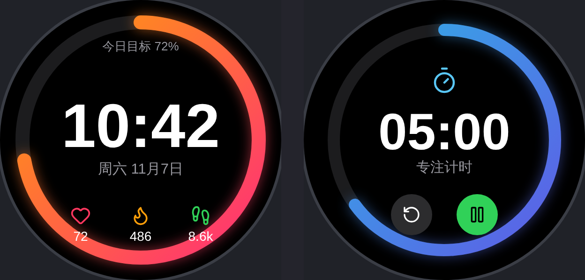
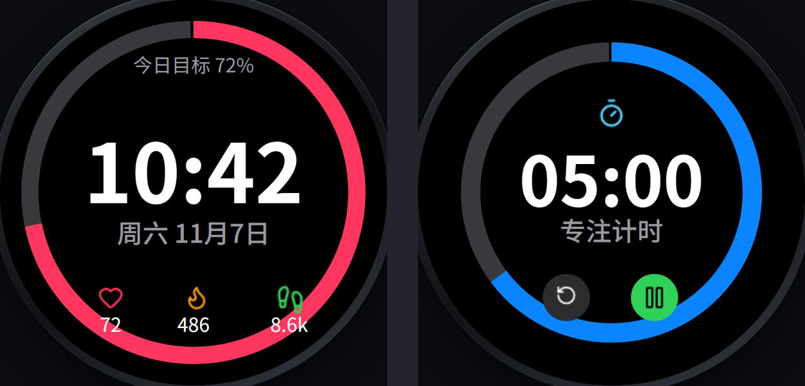

# squareline-design-skills

Turn a **concept image + a requirements document** into a **SquareLine Studio / LVGL project** that opens without errors, looks like the concept,
and provably follows the requirements. 把**概念图 + 需求文档**变成能被 SquareLine Studio 打开、长得像概念图、并且逐条对得上需求的 LVGL 工程。

- requirement tracing (every "must / must not" gets a decision) / 需求追溯
- measuring the concept (`scan`, `fit-font`) instead of eyeballing / 量测概念图
- pre-build lint with coded fixes, real-LVGL text audit (`truth`) / 构建前体检与真 LVGL 真值审计
- a `slx next` workflow driver, so weaker LLMs can follow the pipeline too / 工作流驱动，适配各类大模型

## What it looks like / 效果

| Input: concept image / 输入：概念图 | Output: reverse-rendered `.spj` / 输出：生成工程反渲染 |
|---|---|
|  |  |

The two screens above are built end-to-end from `tests/fixtures/focusring_concept.png` with
`slx.py init → assets → check → build → verify`; the `.spj` was never hand-edited. The output rings are
single-colour because the engine only has `PANEL / LABEL / IMAGE / ARC` — the concept's gradient and glow
are not reproduced. Figures are the toolkit's own reverse render, not mockups.
上面两屏由 `tests/fixtures/focusring_concept.png` 经 `init → assets → check → build → verify` 完整生成，`.spj`
没有手改过。生成图的进度环是单色的：引擎只有 `PANEL / LABEL / IMAGE / ARC`，概念图里的渐变和发光不会复刻。
图片是工具链的反渲染结果，不是示意图。

## Generated files / 生成的工程文件

The deliverable is `squareline/<Name>/<Name>.spj`; open it with SquareLine Studio 1.6.2 → Open Project.
Font subsets, PNGs and editor metadata are written next to it:

```
<Name>/
├── UI需求清单.md  <Name>设计规格文档.md      requirements + design spec (source of truth)
├── <Name>.spec.json  assets.manifest.json   declarative layout + asset manifest
├── assets/images/*.png                      rasterised icons / baked images
├── preview/project_preview.html             reverse-rendered preview (screenshots, diffs)
├── requirements.json  需求追溯矩阵.md        requirement traceability (after `reqs extract/report`)
└── squareline/<Name>/                       ← deliverable project
    ├── <Name>.spj                           project file — open this one
    ├── <Name>.sll  <Name>.slp  Themes.slt  project.info
    └── assets/
        ├── *.png                            images referenced by the project
        └── ui_font_*.c/.bin/.fcfg           font subsets used by the labels
```

Counts from the demo above: 26 files in `squareline/`, 21 objects, 6 images, 4 font subsets, 0 validation errors.

## Install (Claude Code / Cowork)

```
/plugin marketplace add YOUR_GITHUB_USERNAME/squareline-design-skills
/plugin install squareline-design@squareline-design-marketplace
```

Needs Python >= 3.8 (`pip install pillow numpy`) and Node.js; Node packages install themselves on first use. Optional: gcc (for `slx.py truth`), playwright + chromium (screenshots).

## Use with any other LLM agent

Give it [`plugins/squareline-design/AGENTS.md`](plugins/squareline-design/AGENTS.md) (or [`docs/UNIVERSAL_PROMPT.md`](plugins/squareline-design/docs/UNIVERSAL_PROMPT.md)). Everything is a command line:

```bash
python3 plugins/squareline-design/tools/slx.py doctor
python3 plugins/squareline-design/tools/slx.py init MyWatch --width 360 --height 360 --shape CIRCLE --dir ~/work
python3 plugins/squareline-design/tools/slx.py next ~/work/MyWatch      # run after every step
```

Full guide: [`plugins/squareline-design/README.md`](plugins/squareline-design/README.md) - usage, commands, disclosure of what the plugin runs/fetches, verified vs unverified, limits. Changes: [`CHANGELOG.md`](plugins/squareline-design/CHANGELOG.md).

**Status:** the generated `.spj` files have been validated and rendered by the toolkit's own checks, but have **not** been opened in SquareLine Studio itself - please report what you see.

## Licence

MIT, see [LICENSE](LICENSE). Bundled Noto Sans SC is under the SIL OFL ([plugins/squareline-design/fonts/OFL.txt](plugins/squareline-design/fonts/OFL.txt)); other third-party notes in [NOTICE.md](plugins/squareline-design/NOTICE.md).
"SquareLine Studio" is a third-party product name; this project is not affiliated with or endorsed by its makers.
